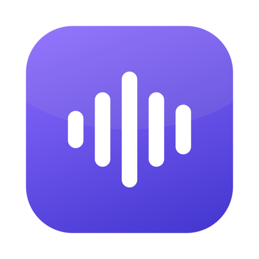
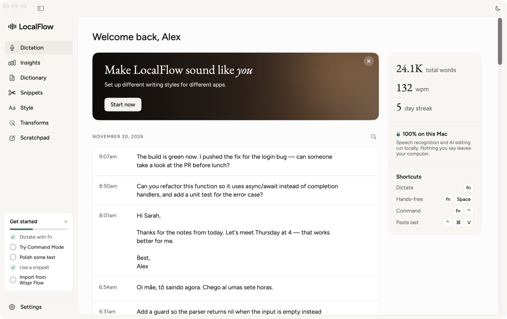
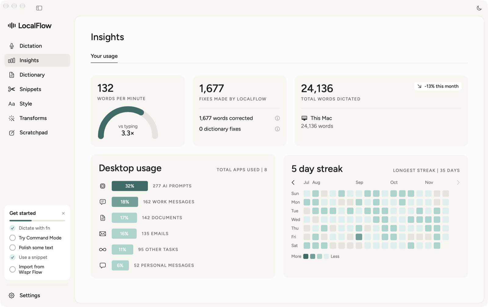
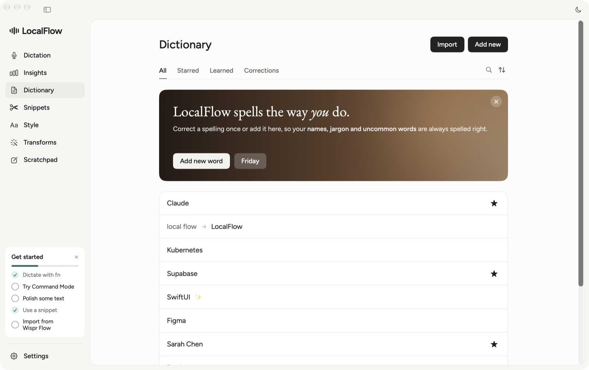
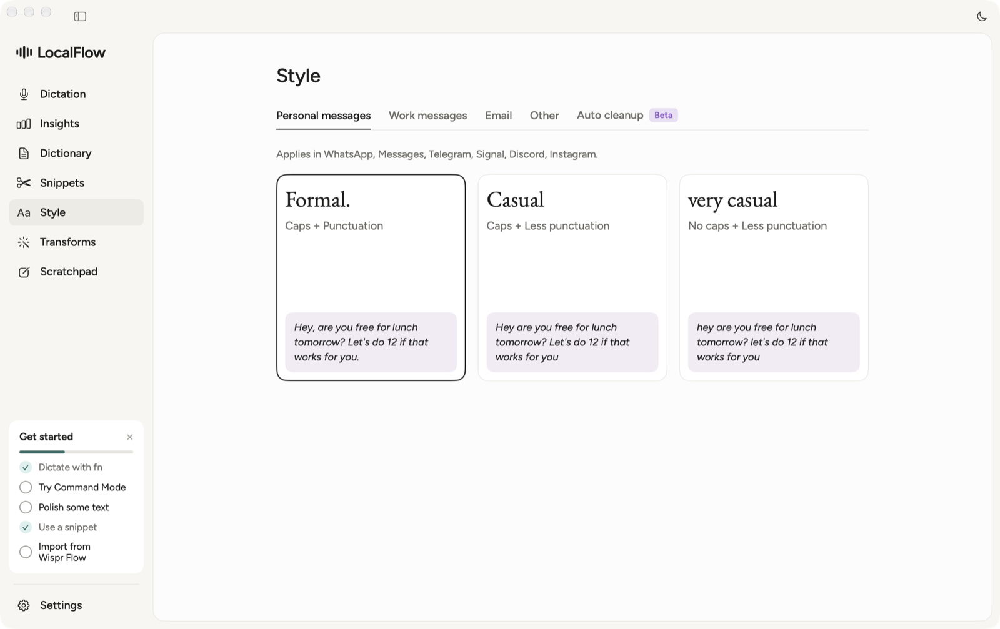
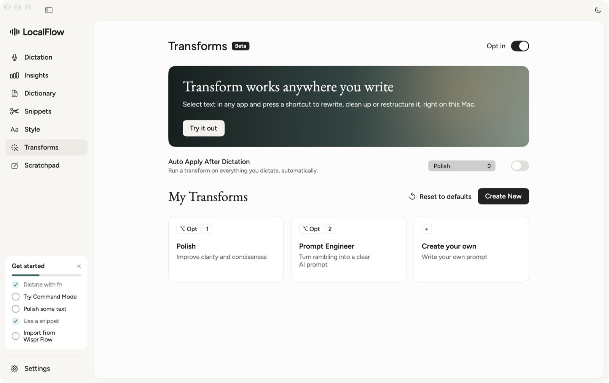

<p align="center">
  
</p>

<h1 align="center">LocalFlow</h1>

<p align="center">
  <b>Private voice dictation for macOS. Speak, and it writes like you.</b><br>
  Hold <kbd>fn</kbd>, talk, let go — clean, punctuated text appears in any app.<br>
  Speech recognition and AI editing run 100% on your Mac. Nothing you say leaves it.
</p>

<p align="center">
  <a href="https://github.com/QuantummDuck/LocalFlow/releases/latest"><b>Download</b></a> ·
  <a href="#features">Features</a> ·
  <a href="#install">Install</a> ·
  <a href="#faq">FAQ</a> ·
  <a href="#build-from-source">Build</a> ·
  <a href="CONTRIBUTING.md">Contributing</a> ·
  <a href="README.pt-BR.md">Português</a>
</p>

<p align="center">
  <a href="https://github.com/QuantummDuck/LocalFlow/releases/latest"></a>
  <a href="https://github.com/QuantummDuck/LocalFlow/releases"></a>
  
  
  
  <a href="https://github.com/QuantummDuck/LocalFlow/actions/workflows/ci.yml"></a>
  <a href="LICENSE"></a>
</p>

<p align="center">
  <picture>
    <source media="(prefers-color-scheme: dark)" srcset=".github/assets/home-dark.png">
    
  </picture>
</p>

> [!NOTE]
> LocalFlow is an independent open-source project inspired by cloud dictation apps such as Wispr Flow. It is not affiliated with or endorsed by Wispr.

## Why LocalFlow?

- **Private by design.** Your voice, your history and your dictionary stay on your Mac. No account, no cloud, no telemetry. After a one-time model download it works fully offline.
- **Fast.** Speech is transcribed on the Neural Engine in ~0.2 s and cleaned up on the GPU in well under a second.
- **It sounds like you.** It removes the "um"s, applies your self-corrections ("Thursday at 3 — no, 4" → "Thursday at 4"), formats lists and emails, and adapts its tone to the app you're typing in.
- **It learns.** Fix a word after it's pasted and LocalFlow adds it to your dictionary automatically.
- **English and Portuguese**, including mixed sentences.
- **Free and open source** under the MIT license.

## Features

| | |
|---|---|
| 🎙️ **Dictate anywhere** | Hold <kbd>fn</kbd> to talk, release to paste at the cursor — in any app. Double-tap <kbd>fn</kbd> or press <kbd>fn</kbd> <kbd>Space</kbd> for hands-free. <kbd>Esc</kbd> cancels. |
| ✨ **Smart cleanup** | A fine-tuned on-device model removes fillers, fixes punctuation, applies self-corrections and formats lists, emails and code-related text. A guard keeps your exact words whenever the model's output looks wrong. |
| 🗣️ **Command Mode** | Hold <kbd>fn</kbd> <kbd>⌃</kbd> and speak an instruction: *"make this more formal"* rewrites your selection, *"write a reply saying I can do Thursday"* writes at the cursor. |
| 🪄 **Transforms** | Select text and press <kbd>⌥</kbd> <kbd>1</kbd> to Polish it or <kbd>⌥</kbd> <kbd>2</kbd> to turn a ramble into a clear AI prompt. Create up to 8 of your own, each with its own shortcut. |
| 📖 **Dictionary** | Teach it names, jargon and spellings. Words you correct after pasting are learned automatically. |
| ✂️ **Snippets** | Say *"my calendar link"* and get the full URL — even in the middle of a sentence. |
| 🎨 **Styles** | Formal, casual, very casual or excited — set separately for personal messages, work chat, email and everything else. |
| 📊 **Insights** | Words per minute, words dictated, fixes, usage by app type and a streak calendar, all computed locally. |
| 📝 **Scratchpad** | <kbd>⌥</kbd> <kbd>S</kbd> opens a floating notepad to think out loud. |
| 🔁 **Bring your history** | Import your dictation history and dictionary from Wispr Flow in one click. |

<table>
  <tr>
    <td></td>
    <td></td>
  </tr>
  <tr>
    <td align="center"><sub>Insights</sub></td>
    <td align="center"><sub>Dictionary</sub></td>
  </tr>
  <tr>
    <td></td>
    <td></td>
  </tr>
  <tr>
    <td align="center"><sub>Style</sub></td>
    <td align="center"><sub>Transforms</sub></td>
  </tr>
</table>

## Install

**Requirements:** a Mac with Apple Silicon (M1 or later), macOS 15 Sequoia or later, and about 5 GB of free space for the models.

1. Download **`LocalFlow.dmg`** from the [latest release](https://github.com/QuantummDuck/LocalFlow/releases/latest).
2. Open it and drag **LocalFlow** into **Applications**.
3. Open LocalFlow. Because it isn't notarized by Apple, macOS will block it the first time: open **System Settings → Privacy & Security**, scroll down and click **Open Anyway**.
4. Follow the onboarding: allow **Microphone** and **Accessibility** (needed to hear you and to type for you).
5. Wait for the one-time model download (~4 GB, progress is shown on the Home screen). Then hold <kbd>fn</kbd> and start talking.

> [!TIP]
> If pressing <kbd>fn</kbd> opens the emoji picker, set **System Settings → Keyboard → Press 🌐 key to → Do Nothing**.

## Keyboard shortcuts

All shortcuts can be changed in **Settings → General → Keyboard shortcuts**.

| Action | Default |
|---|---|
| Push to talk | Hold <kbd>fn</kbd> |
| Hands-free (start / stop) | Double-tap <kbd>fn</kbd> or <kbd>fn</kbd> <kbd>Space</kbd> |
| Command Mode | Hold <kbd>fn</kbd> <kbd>⌃</kbd> |
| Cancel | <kbd>Esc</kbd> |
| Paste last transcript | <kbd>⌃</kbd> <kbd>⌘</kbd> <kbd>V</kbd> |
| Copy last transcript | <kbd>⌃</kbd> <kbd>⌘</kbd> <kbd>C</kbd> |
| Scratchpad | <kbd>⌥</kbd> <kbd>S</kbd> |
| Polish selection | <kbd>⌥</kbd> <kbd>1</kbd> |
| Prompt Engineer | <kbd>⌥</kbd> <kbd>2</kbd> |

## How it works

```
hold fn ─► microphone ──────────────┐      app context (which app, text near the cursor, names on screen)
release ─► Parakeet speech-to-text ◄┘                         │
            (Neural Engine, ~0.2 s)                           ▼
        ─► cleanup model (fine-tuned Qwen3 1.7B, GPU) ─► guard ─► snippets ─► dictionary ─► style ─► paste
```

| Model | Used for | Size | Source |
|---|---|---|---|
| [Parakeet Ultra](https://huggingface.co/FluidInference/parakeet-ultra-coreml) (Core ML, 25 languages) | Speech to text | ~0.6 GB | Downloaded by [FluidAudio](https://github.com/FluidInference/FluidAudio) |
| LocalFlow cleaner + cleaner-fix (Qwen3 1.7B, LoRA fine-tune, 4-bit) | Cleanup and self-corrections | 2 × 0.95 GB | This repo's [models release](https://github.com/QuantummDuck/LocalFlow/releases/tag/models-v1) |
| [Qwen3 4B Instruct 2507](https://huggingface.co/mlx-community/Qwen3-4B-Instruct-2507-4bit) (4-bit, MLX) | Command Mode, Transforms, Medium cleanup | 2.3 GB | Hugging Face (loaded on demand, freed when idle) |

Everything lives in `~/Library/Application Support/LocalFlow/`: your history, dictionary, notes, the last 14 days of audio (for *Retry*), and the models. Delete that folder and LocalFlow is gone without a trace.

## FAQ

<details>
<summary><b>Does anything leave my Mac?</b></summary>

No. The only network access is the one-time model download from GitHub and Hugging Face (and the "search …" voice command, which opens your browser). There is no account, analytics or crash reporting.
</details>

<details>
<summary><b>macOS says LocalFlow "can't be opened" or "is damaged".</b></summary>

The release is not notarized (that requires a paid Apple Developer account). Use **System Settings → Privacy & Security → Open Anyway**, or run `xattr -dr com.apple.quarantine /Applications/LocalFlow.app`. You can also [build it yourself](#build-from-source).
</details>

<details>
<summary><b>Holding fn does nothing.</b></summary>

Check that LocalFlow has **Accessibility** permission (System Settings → Privacy & Security → Accessibility). After updating the app, macOS sometimes needs the permission toggled off and on again.
</details>

<details>
<summary><b>Does it work on Intel Macs?</b></summary>

No. The models run on Apple Silicon's Neural Engine and GPU through Core ML and MLX.
</details>

<details>
<summary><b>Which languages are supported?</b></summary>

English and Portuguese are tuned and tested. Parakeet recognizes 25 European languages, so others may work with lighter cleanup.
</details>

<details>
<summary><b>Can I train the cleanup model on my own writing?</b></summary>

Yes. See [docs/TRAINING.md](docs/TRAINING.md). If you used Wispr Flow, your history makes a great training set.
</details>

## Build from source

Requirements: Xcode 26 or later, [XcodeGen](https://github.com/yonaskolb/XcodeGen) (`brew install xcodegen`).

```bash
git clone https://github.com/QuantummDuck/LocalFlow.git
cd LocalFlow
scripts/install.sh            # builds a Release app and installs it to /Applications
```

Run the text-processing self-test:

```bash
swift build -c release --product flowbench && .build/release/flowbench selftest
```

| Path | What's inside |
|---|---|
| `App/LocalFlow` | The macOS app: pipeline and hotkeys (`Flow.swift`, `Hotkeys.swift`), mic, context and paste (`Input.swift`), storage (`Store.swift`), model downloads (`Models.swift`), UI (`Hub.swift`, `Pages.swift`, `Theme.swift`, `Overlay.swift`) |
| `Sources/FlowCore` | Speech recognition wrapper, cleanup models and guard, dictionary, snippets and styles |
| `Sources/flowbench` | Self-test and benchmarks |
| `bench/` | Python tools to build training data, fine-tune and score the cleanup model |
| `docs/` | [Feature spec](docs/FEATURES.md), [research notes](docs/RESEARCH.md), [training guide](docs/TRAINING.md) |

## Contributing

Bug reports, ideas and pull requests are welcome — see [CONTRIBUTING.md](CONTRIBUTING.md). For security issues, see [SECURITY.md](SECURITY.md).

## Acknowledgements

- [FluidAudio](https://github.com/FluidInference/FluidAudio) and [Parakeet Ultra](https://huggingface.co/moondream/parakeet-ultra) by Moondream, built on NVIDIA's [Parakeet TDT 0.6B v3](https://huggingface.co/nvidia/parakeet-tdt-0.6b-v3) (CC-BY-4.0), for speech recognition
- [MLX Swift](https://github.com/ml-explore/mlx-swift) and [mlx-swift-lm](https://github.com/ml-explore/mlx-swift-examples) for on-device language models
- [Qwen3](https://github.com/QwenLM/Qwen3) (Apache 2.0) base models
- [Figtree](https://github.com/erikdkennedy/figtree) and [EB Garamond](https://github.com/octaviopardo/EBGaramond12) fonts (SIL Open Font License)

## License

LocalFlow is released under the [MIT License](LICENSE). The bundled fonts and the downloaded models keep their own licenses, listed above.
