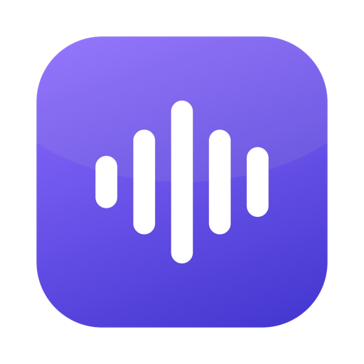
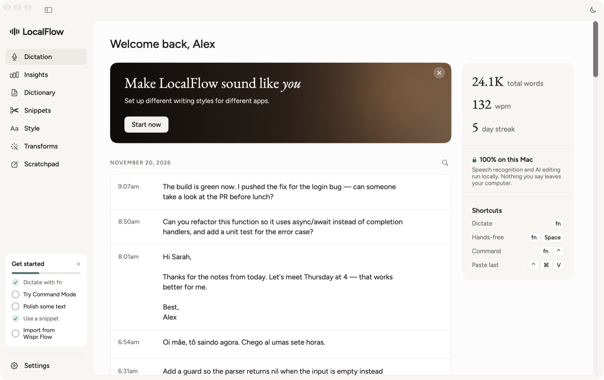

  

<h1 align="center">LocalFlow</h1>

  <b>Ditado por voz privado para macOS. Você fala, e ele escreve do seu jeito.</b> 
  Segure <kbd>fn</kbd>, fale e solte — o texto limpo e pontuado aparece em qualquer app. 
  O reconhecimento de voz e a edição com IA rodam 100% no seu Mac. Nada do que você diz sai dele.

  <a href="https://github.com/QuantummDuck/LocalFlow/releases/latest"><b>Baixar</b></a> ·
  <a href="#instalação">Instalação</a> ·
  <a href="#atalhos">Atalhos</a> ·
  <a href="README.md">English</a>

  <picture>
    <source media="(prefers-color-scheme: dark)" srcset=".github/assets/home-dark.png">
    
  </picture>

> [!NOTE]
> O LocalFlow é um projeto independente e de código aberto, inspirado em apps de ditado na nuvem como o Wispr Flow. Não tem nenhuma afiliação com a Wispr.

## Por que o LocalFlow?

- **Privado.** Sua voz, seu histórico e seu dicionário ficam no seu Mac. Sem conta, sem nuvem, sem telemetria. Depois do download único dos modelos, funciona totalmente offline.
- **Rápido.** A fala é transcrita no Neural Engine em ~0,2 s e revisada na GPU em menos de um segundo.
- **Escreve como você.** Tira os "hum", aplica suas autocorreções ("quinta às 3, não, às 4" → "quinta às 4"), formata listas e e-mails e ajusta o tom ao app em que você está.
- **Aprende.** Corrigiu uma palavra depois de colar? O LocalFlow adiciona ao seu dicionário sozinho.
- **Português e inglês**, inclusive misturados na mesma frase.
- **Grátis e de código aberto** (licença MIT).

## Recursos

- 🎙️ **Ditado em qualquer app** — segure <kbd>fn</kbd> para falar; toque duas vezes ou use <kbd>fn</kbd> <kbd>Espaço</kbd> para o modo mãos-livres.
- ✨ **Limpeza inteligente** — um modelo ajustado roda no próprio Mac; se a saída parecer errada, suas palavras originais são mantidas.
- 🗣️ **Modo Comando** — segure <kbd>fn</kbd> <kbd>⌃</kbd> e diga *"deixa isso mais formal"* ou *"escreve uma resposta dizendo que quinta eu posso"*.
- 🪄 **Transformações** — <kbd>⌥</kbd> <kbd>1</kbd> dá um polimento no texto selecionado; <kbd>⌥</kbd> <kbd>2</kbd> transforma ideias soltas em um prompt claro para IA.
- 📖 **Dicionário**, ✂️ **Snippets**, 🎨 **Estilos** por tipo de app, 📊 **Estatísticas**, 📝 **Bloco de notas** (<kbd>⌥</kbd> <kbd>S</kbd>).
- 🔁 **Importe seu histórico do Wispr Flow** com um clique.

## Instalação

**Requisitos:** Mac com Apple Silicon (M1 ou superior), macOS 15 ou superior e ~5 GB livres para os modelos.

1. Baixe o **`LocalFlow.dmg`** na [versão mais recente](https://github.com/QuantummDuck/LocalFlow/releases/latest).
2. Abra e arraste o **LocalFlow** para **Aplicativos**.
3. Abra o LocalFlow. Como ele não é notarizado pela Apple, o macOS vai bloquear na primeira vez: vá em **Ajustes do Sistema → Privacidade e Segurança** e clique em **Abrir Mesmo Assim**.
4. Siga a configuração inicial e permita **Microfone** e **Acessibilidade**.
5. Aguarde o download único dos modelos (~4 GB, com progresso na tela inicial). Depois é só segurar <kbd>fn</kbd> e falar.

> [!TIP]
> Se o <kbd>fn</kbd> abrir o painel de emojis, ajuste **Ajustes do Sistema → Teclado → Pressionar a tecla 🌐 para → Não Fazer Nada**.

## Atalhos

| Ação | Padrão |
|---|---|
| Falar (segurar) | <kbd>fn</kbd> |
| Mãos-livres | Toque duplo em <kbd>fn</kbd> ou <kbd>fn</kbd> <kbd>Espaço</kbd> |
| Modo Comando | <kbd>fn</kbd> <kbd>⌃</kbd> |
| Cancelar | <kbd>Esc</kbd> |
| Colar última transcrição | <kbd>⌃</kbd> <kbd>⌘</kbd> <kbd>V</kbd> |
| Bloco de notas | <kbd>⌥</kbd> <kbd>S</kbd> |

Todos podem ser alterados em **Ajustes → Geral**. Para compilar a partir do código, detalhes técnicos e créditos, veja o [README em inglês](README.md).
